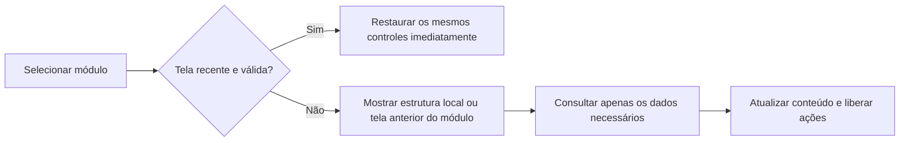

# Navegação e carregamento — CS Booster 0.3.2

## O que causava a tela intermediária

Na 0.3.1, `navigate()` substituía todo o conteúdo por “Carregando informações…” antes de chamar o módulo. As funções de página aguardavam consultas por IPC antes de produzir sua interface. `loadCatalog()` reaproveitava o catálogo, mas consultava novamente os estados dos ajustes; módulos que só precisavam de metadados também faziam essa leitura.

O adaptador de registro iniciava nove processos PowerShell para ler os valores dos seis ajustes. No painel, a leitura dos estados, a consulta de hardware e as preferências eram aguardadas em sequência. A prévia da limpeza, por sua vez, executa verificações que podem levar tempo. O indicador intermediário era, portanto, uma decisão do nosso código, somada ao custo de consultas repetidas.

## Comparação com o aplicativo distribuído

Inspeção estática do renderer TogsBoost, SHA-256 `d492fc0d7e688903ffa8ca295cc8ac31b1cc7dd887350914e59b5f7d1fdf2b56`:

| Área | Observação no código distribuído |
| --- | --- |
| Rotas | Referenciam componentes já definidos no bundle, sem uma tela global de carregamento em volta de todas as rotas |
| Painel | Lê dados locais/armazenados e agenda atualização de informações do sistema em segundo plano com `requestIdleCallback` |
| Limpeza | Monta opções locais e consulta a última limpeza no armazenamento; não aguarda uma prévia completa por IPC para montar a tela |
| Configurações | Renderiza com estado inicial e consulta a integração Discord posteriormente |
| Ajustes | Tem estado explícito de carregamento; busca ajustes e estados em paralelo |
| Restauração | Também possui carregamento explícito antes da lista |

Não é correto concluir que o TogsBoost nunca mostra carregamento. A diferença confirmada é a separação entre montar certas telas e atualizar seus dados. React ou `startTransition`, por si só, não comprovam consultas mais rápidas. A lógica principal em Bytenode (`index.jsc`) e sua latência continuam desconhecidas nesta investigação.

## Evidência REA e limite do Ghidra

Foram analisados cinco recortes literais, sem execução, dos intervalos de bytes UTF-8 `[início,fim)` abaixo. Eles permaneceram fora do código publicado.

| Recorte | Função | Intervalo |
| --- | --- | --- |
| dashboard.js | cE | `[401205,410799)` |
| tweaks.js | fE | `[416812,427157)` |
| cleanup.js | hE | `[427556,433033)` |
| settings.js | xE | `[483437,493366)` |
| routes.js | _E | `[518829,520251)` |

REA: evidência completa `ev_0adeb4390565ab2e8304de4bb37a6b90e5aedc8fadd0ec383d51f147eda69222`; resumo `ev_d4844da5b66e9dd23e7f089ebae930b2fd7b0ea687d55d6f105b3d6d164b71d8`. Foram examinados 36.767 bytes e 7.109 nós AST em cinco arquivos, sem falha de sintaxe. A cobertura semântica permanece incompleta por depender de símbolos externos e do restante do aplicativo. Análise estática não prova execução ou tempos de frames do TogsBoost.

O Ghidra 12.1.4 foi acionado por REA CLI no executável nativo de SHA-256 `c0b095f9921a7ccd91c0cb2548f3cd0a391549060bac89f6c7632234c4bb2130`, evitando o limite de chamada do cliente. Após corrigir somente o diretório temporário do processo — o caminho automático continha caracteres rejeitados pelo Ghidra — a importação e a análise começaram, mas atingiram o prazo de 900 segundos. Não houve resultado completo de decompilação. As conclusões sobre navegação vêm do renderer examinado com REA e da comparação com o código próprio, não de uma decompilação nativa concluída.

## Implementação própria

- Consultas de leitura em memória por até dez segundos, com deduplicação das que estão em andamento. Não há gravação desse cache no disco.
- Telas recentes preservam seus próprios elementos e eventos; a volta não reconstrói a página nem repete consultas. Há no máximo as nove páginas conhecidas.
- Ao expirar ou invalidar uma tela, seu conteúdo pode continuar visível durante a atualização, com as ações bloqueadas até a verificação. Na primeira visita, a estrutura local aparece antes dos dados. Um aviso discreto substitui a tela global de carregamento.
- Alterações, inclusive falhas ou resultados parciais, invalidam as consultas. Uma resposta antiga não repõe o cache depois de invalidado. O botão de atualização força uma consulta nova; retorno de foco também invalida dados.
- Respostas de uma navegação superada não substituem o módulo atual. As verificações do backend antes de alterar o Windows permanecem em vigor; nenhum estado é marcado como aplicado antecipadamente.
- As nove leituras do registro passaram a uma consulta PowerShell, preservando erro e estado desconhecido por ajuste. Painel e segurança fazem consultas independentes em paralelo. Módulos de orientação não carregam os estados dos ajustes sem necessidade.

## Validação

84 testes de lógica e fixtures: 83 aprovados, nenhuma falha e uma omissão conhecida de junction. Os testes cobrem deduplicação, prazo, falha, invalidação durante consulta, retorno sem consulta, preservação dos elementos, atualização explícita e respostas atrasadas. A consulta de registro agrupada foi testada em modo somente leitura.

Na prévia, o retorno Configurações → Apps → Configurações mostrou `cacheHit=true`, conservou o campo de edição e não mostrou a tela global de carregamento. O valor não foi salvo. A limpeza manteve as oito opções e suas restrições.

O teste desktop da 0.3.2 acrescenta retorno a módulo sem novas consultas, preservação do campo e atualização explícita. Foi aprovado em relatório novo da versão 0.3.2: retorno com zero consultas, formulário preservado e atualização explícita verificados. A captura do painel oculto falhou com UnknownVizError; o aviso foi registrado separadamente. Não foi medida equivalência de latência com o TogsBoost nem ganho de FPS.
